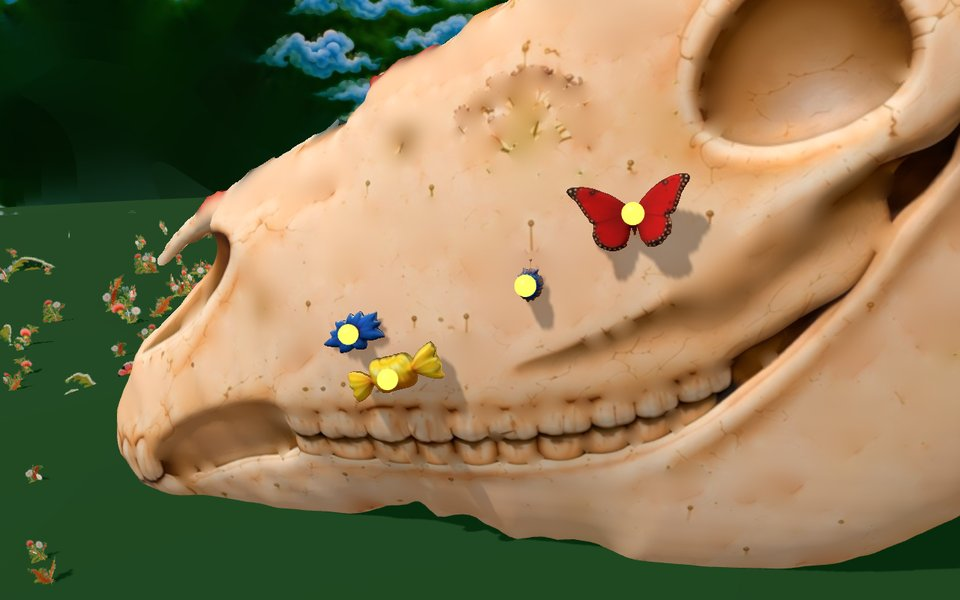

# Single-image lift

This experiment measures whether the asset pipeline can turn one new image of one thing into a pinnable model with adjustment criteria in a few seconds. [Described things: type or dictate what belongs on a spot · Issue #27](https://github.com/albion-house/venorn/issues/27) leaves this open, since a full `mise //venorn-asset-pipeline:build` takes about 85 seconds.

No image generator was called. The stand-ins for generated images are things cut from the painting.

## Result

A process that keeps the models loaded turns one image into a model in about 2.5 seconds. If the image shows the thing on a flat plain ground, keying out the ground replaces the detector and the segmenter, and the model takes about 0.4 seconds. Starting a new process for each image took 10 to 31 seconds, most of it spent importing PyTorch, loading the models and making the first call to each model.

## Stand-ins

`cut_standins.py` cuts four things out of the cached painting, at the boxes the catalog found for them: the large red butterfly on the cheek (`butterfly-002`), the yellow candy on the brow (`candy-011`), a blue flower (`flower-007`) and the blue jewel (`bead-018`). Each is a square enlarged to 1024 pixels, in two versions:

- `painted` keeps the bone and the neighboring things around it.
- `plain` keeps only the thing, on a paper-colored ground, using the outline the catalog found. This is what an image generator asked for one thing on a plain background would return.

Each stand-in has the description a player might type, such as "a red butterfly".

## The stages one image needs

`lift_one.py` runs these stages on each image and times each one.

- **detect**: Grounding DINO looks for the description in the whole image and the best box is kept. The build's catalog stage runs the detector over overlapping tiles of the whole painting. One image needs one call.
- **segment**: SAM outlines the thing inside the box. With `--key`, the ground color is read from the image's border and every pixel far from it belongs to the thing, with no model.
- **cut**: the crop, enlargement and soft edge that the isolate stage gives each thing. Nothing else of the isolate stage is needed: no bare skull, no features, no contact sheet.
- **classify**: SigLIP names the nearest of the painting's five pinned kinds. That kind lends the described thing its thickness, its size in the painting, and its criteria, such as a butterfly's fold.
- **depth**, **heights** and **mesh**: the lift stage for one thing, with the relief backend: a depth estimate, the height maps, and the textured mesh.
- **write**: the GLB, the preview PNG, and the adjustment criteria, checked against `schemas/adjustment.schema.json`.

The fetch and layers stages are not needed. In place of the export stage, `add_to_assets.py` copies the three files into an asset set and adds them to its manifest.

## Numbers

Measured on an Apple M2 Pro with 16 GB, macOS 27.2.1, with the model weights already in `~/.cache/huggingface/hub` and `HF_HUB_OFFLINE=1`. SAM and the depth model run on the Apple GPU. Grounding DINO and SigLIP run on the CPU, as `venorn_assets/models.py` places them. Three other agents shared the Mac, and 16 GB of swap was in use. The per-image numbers come from runs at a load average of 3 to 4. Earlier runs at a load average of 60 to 70 took about twice as long. The time to load the models varied the most.

Each later image in one process, the median of 23 images on the detector path and 11 on the keyed path:

| Stage | Detector path | Keyed ground |
| --- | --- | --- |
| detect | 1.35 s | none |
| segment | 0.74 s | 0.05 s |
| cut | 0.01 s | 0.01 s |
| classify | 0.13 s | 0.10 s |
| depth | 0.06 s | 0.05 s |
| heights | 0.11 s | 0.11 s |
| mesh | 0.04 s | 0.04 s |
| write | 0.03 s | 0.02 s |
| total | 2.54 s, from 2.21 to 7.39 | 0.38 s, from 0.37 to 0.45 |

Paid once by each new process:

- Importing PyTorch, transformers and the pipeline: 2.6 to 4.5 s.
- Loading the models: SigLIP 4.7 to 9.1 s, SAM 0.35 to 1.8 s, Grounding DINO 0.32 to 1.3 s, the depth model 0.22 to 0.91 s.
- The first image: 3.2 to 12.8 s on the detector path and 0.7 to 6.0 s keyed. The first call to each model is slower than the ones after it.
- One image from the command to the written model: 16 to 31 s on the detector path and 10 to 21 s keyed.
- The process holds about 3.4 GB of memory on the detector path and 1.7 GB keyed.

The full build took 135 s in this worktree, while `uv sync` set up the worktree's environment and the other agents were running.

Every stand-in came out as a clean cutout, and the classifier named the right kind for each, at 0.82 to 1.0.

## What would make it fast

- A process that stays running. It loads the four models once, sends one stand-in through to warm each model, and then lifts each image as it arrives. That removes 10 to 30 s from every described thing and leaves 2.5 s.
- A plain ground. If the image generator is asked for one thing on a flat plain ground, keying the ground out replaces the detector and the segmenter, and leaves 0.4 s. The detector is the slowest stage because Grounding DINO runs on the CPU: it uses operators the Apple GPU backend lacks.
- A frame-sized box given to SAM is not a way to skip the detector. On the plain stand-ins it outlined the whole paper-colored square.

The remaining stages take about 0.35 s together, and none of them takes more than 0.13 s.

## In the viewer

`add_to_assets.py` adds the models to the exported asset set as a sixth category, "Described". `check_viewer.cjs` opens the viewer in headless Google Chrome, presses `6`, and pins each described thing to the cheek with a click. The dock then lists "Described (6)", and the glitter pen's key becomes `7`. The run below used the four models made from the painted stand-ins.



The picture was read from the canvas after the four clicks, with the camera moved closer. `viewer-close.jpg` is a smaller copy of the PNG the script writes.

## Not checked

- A generated image. The stand-ins are things from the painting, so the classifier knows them. A thing unlike the five kinds, such as a key or a shell, was not tried.
- Keying out the ground of a generated image. The plain stand-ins were made from the catalog's outlines, so keying recovers those outlines by construction. A real generated image may have a shadow or a gradient behind the thing.
- How long ChatGPT, a model on the Mac, or a hosted service takes to make the image.
- The described things from the far side, and on a phone.

## Running it

From the repository root, after `mise //venorn-asset-pipeline:build`:

```sh
E=openspec/changes/add-described-things/experiments/single-image-lift
OUT=/tmp/single-image-lift

uv run --project venorn-asset-pipeline python $E/cut_standins.py $OUT/standins

# The detector path, every stand-in three times in one process
uv run --project venorn-asset-pipeline python $E/lift_one.py $OUT/standins/standins.json --out $OUT/detector --repeat 3

# The keyed path, on the plain stand-ins
uv run --project venorn-asset-pipeline python $E/lift_one.py $OUT/standins/standins.json --out $OUT/keyed --key --repeat 3 \
  --only butterfly-plain.png --only candy-plain.png --only flower-plain.png --only bead-plain.png
```

Each run prints the time of each stage and writes `timings.json` beside the models.

To see the models in the viewer, add them to the asset set, serve the client, and run the check. Playwright is not a client dependency, so `NODE_PATH` points at a `node_modules` directory that has it:

```sh
uv run --project venorn-asset-pipeline python $E/add_to_assets.py $OUT/detector
mise //venorn-game-client:dev --port 5204 &
NODE_PATH=/path/to/node_modules node $E/check_viewer.cjs http://localhost:5204/ $OUT/viewer
```

Run the build again to take the sixth category back out of the asset set.
